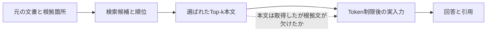

# RAG内部の監査・可視化を研究テーマにする方向の検討

採用状況（2026年10月18日）: 主テーマは[自己評価の順序感度と修復判断の分析](rag_research_plan.md)に決定した。
本書の可視化単独案は保留。Viewerは主実験を優先した任意の補助成果物とする。

調査日: 2026年10月18日。状態: **追加のテーマ候補。採用決定・実装・実験結果ではない。**
ユーザーの条件: 他の研究者に役立つRAG内部の可視化を検討する。**操作評価の参加者は集めずに進めたい。**
投稿先と通常締切は[ICIAE向け調査メモ](iciae2027_research_direction_review.md)を参照する。

## 1. 判断

RAGの可視化・診断支援は学術研究として成立しており、国際会議の採録例もある。
ただし、検索文書・Prompt・回答を表示する、注意重みを色付けする、文書を外して再生成する、
複数設定を比較するという機能は既存である。汎用Dashboardの新規開発だけでは差別化しにくい。

本プロジェクトでは、**実際のモデル入力に至る根拠の保持・欠落を監査し、可視化する研究**を主候補とする。
主張は実行記録の正確性、根拠保持の測定、粗い評価で見落とす事例、再現可能な分析に置く。
参加者評価を行わないため、人の診断時間短縮、理解度向上、使いやすさの実証は主張しない。
可視化は分析結果を研究者が点検できる成果物と位置づけ、機能数や画面の見栄えを主貢献にはしない。

## 2. 何を「内部」として見えるようにするか

| 対象 | 記録・検証できる内容 | 解釈の限界 |
|---|---|---|
| Pipelineの実行過程 | 質問、検索順位、選択文書、切詰め、モデルへ送った入力、出力、時間 | 実行記録から分かる事実。LLM内部の推論過程全体ではない |
| 回答と根拠の対応 | 引用ID、主張を支持する文、評価器による支持判定 | 引用や支持関係だけで、モデルが実際に依存したと確定しない |
| 介入したときの出力変化 | 根拠追加・削除・置換後の再生成、Seed、条件、費用 | その介入の条件下での挙動。唯一の真因や内部機構を証明しない |
| 重み・活性・Attention | 層/Head/Tokenごとの数値など | 専用の計測が必要で、Attentionの大きさを原因と同一視しない |

[Correctness is not Faithfulness in RAG Attributions](https://arxiv.org/abs/2412.18004)は、
引用文書が主張を支持することと、生成がその文書に依存したことを区別する。
Attentionの解釈にも議論があり、[Jain & Wallace](https://aclanthology.org/N19-1357/)と
[Wiegreffe & Pinter](https://aclanthology.org/D19-1002/)は異なる検証の必要性を示す。
Attentionを無意味と断定するのでも、色の濃さを理由の証明とするのでもなく、計測対象に応じて検証する。
現状の実装からは、最初のPipeline監査が最も直接取り組める。

## 3. 主要な既存研究・ツール

| 研究/ツール | 確認した機能と重なり | 掲載情報・確認範囲 |
|---|---|---|
| [RAGViz](https://aclanthology.org/2024.emnlp-demo.33/) | Token/文書のAttention表示、文書追加・削除後の生成比較 | EMNLP 2024 System Demonstrations。公式掲載/Abstract |
| [RAGVUE](https://aclanthology.org/2026.eacl-demo.35/) | 検索・回答・Claim根拠性の説明付き評価、Judge間の変動、ローカルUI | EACL 2026 System Demonstrations。公式掲載、著者版の評価/Calibration |
| [InspectorRAGet](https://aclanthology.org/2025.naacl-demo.13/) | モデル/指標/Annotationの比較、個別例、評価者間の一致と不確実性 | NAACL 2025 System Demonstrations。公式掲載、本文第2〜4節 |
| [RAGTrace](https://arxiv.org/abs/2508.06056) | 検索と生成の関係、根拠追跡、設定変更と失敗分析 | 著者版にUIST 2025採録と記載。本文のUI/評価 |
| [RAGExplorer](https://arxiv.org/html/2601.12991v2) | 複数設定の比較、段階別失敗分類、根拠欠落、Context介入と再生成 | 著者版にIEEE TVCG/PacificVis 2026採録と記載。本文第2〜4/6〜7節 |
| [RAGGY](https://arxiv.org/html/2504.13587v1) | Query/Retriever/LLM/Answerのセル、実Prompt表示、途中から再実行 | 2025年arXiv版として確認。本文第4節と評価。採録先は未確認 |
| [FootprintRAG](https://arxiv.org/html/2609.19601v1) | 文献探索で、検索・選別・除外された候補と根拠の改訂を可視化 | 2026年9月arXiv版。証拠構築/可視化を確認。採録先は未確認 |
| [LLM-FACETS](https://arxiv.org/abs/2605.31167) | Token確率、多数Judge、Claim別評価をUIで表示 | 2026年arXiv版。透明性/複数Judgeの方法。採録先は未確認 |
| [Phoenix公式資料](https://arize.com/docs/phoenix/tracing) | LLM・検索・ToolのTrace、入出力・時間・Token・評価 | 研究論文とは区別する実用ツール。公式資料の機能確認 |

このため、以下を単独の新規性とはしない。

- 「RAGを可視化する」「研究者向けにする」「ローカルで使える」。
- 文書と回答を線で結ぶ、R/F/A Scoreを図示する、複数JudgeのScoreを並べる。
- 検索失敗と生成失敗を分ける、検索後に根拠が欠ける場合を表示する。
- 文書を削除して再生成する、複数のRAG設定を比較する。

原論文に既にある機能の有無と、本研究で新しく測る問いを区別する。
InspectorRAGetはCLAPNQの分析例も既に含むため、このDatasetを用いること自体も差別化にならない。
全ツールを動かした同条件比較や全論文の全文精読を完了したものではない。

## 4. 推薦する主案: モデル実入力までの根拠保持を追跡する

仮題: **RAGにおける根拠保持と欠落の実行時監査・可視化**

英語仮題: **Auditing and Visualizing Evidence Preservation in RAG Context Construction**

### 問題の具体例

文書AがTop-10に入り、回答に必要な文がその後半にあっても、文書本文の512 Token制限で
必要な部分が落ちる場合が考えられる。文書IDだけでは「正解文書を取得した」と見えるが、
LLMの入力にはその根拠が存在しない。この場合と、根拠が入力に残ったまま誤答する場合を区別する。
これは説明用の想定例であり、現在の5問でその根拠消失を確認したという意味ではない。

各段階の残存本文と根拠箇所を対応付け、欠落の位置・理由・条件を保存する。
生成器が「利用した」と分かる範囲を超えて表示せず、「入力された」「引用された」「支持と判定された」を分ける。

### 研究質問

- RQ1: 文書単位の検索成功と、実入力での根拠文の保持はどの程度ずれるか。
- RQ2: そのずれは文書内の根拠位置、本文上限、全体Token予算によってどう変わるか。
- RQ3: 根拠の欠落を含む失敗を、検索側・Context構築側・生成側へ粗く分けたとき、何を見落とすか。
- RQ4: 記録・対応付け・表示を追加しても、元の入力と回答を変えずに解析できるか。費用はどれだけか。

RQ3の対象は観測可能な欠落事象とその分類であり、真の内部原因が一意に分かったという意味ではない。
根拠復元の追加実験をする場合は、回答改善との関係を別に測る。

### 最も近い研究との差と、新規性の難しさ

RAGExplorerは最終Contextに根拠が入らない失敗を既に扱っている。
RAGGYもモデルへ送るPromptを表示するため、「実Promptを表示すること」が新しいとは言えない。
FootprintRAGにも除外候補の可視化があり、欠落した根拠の表示だけでは重なる。

差分候補は、**同じ文書が選択され続けても、その内部の根拠文が実際のTokenizerと入力整形によって
どこで失われるかを、元の自由文回答の生成条件を保って測る評価Protocolと追跡Data**である。
単なる細粒度化やCLAPNQへの変更で終わらず、既存の粗い観測では区別できない事例がどの程度あり、
測定・診断の結論をどれだけ変えるかを示す必要がある。

有意義な欠落がほぼ見つからない場合、または既存手法の再現だけで同じ分析ができる場合は、
本案の独自性・重要性を見直す。現時点ではこの差分の新規性や効果を確立していない。

## 5. 想定する成果物

| 成果物 | 研究者ができること |
|---|---|
| 実行ログの仕様と変換処理 | 文書全文・選択・実入力・回答を共通のRunへ結び付ける |
| 根拠箇所の保持/欠落Report | 検索成功と実入力での根拠保持を区別して集計する |
| ローカル可視化Viewer | 順位、本文差分、切詰め箇所、実Prompt、引用先を点検する |
| 再現用Caseと分析Script | 同じ条件の欠落・部分保持・代替根拠の事例を追試する |
| 研究論文 | 欠落が生じる条件、測定上の見落とし、計測費用と限界を説明する |

初期Viewerは一問の段階表示、本文差分、保存済み条件間の比較に絞る。
説明のために、実際には記録していない理由・推論経路をLLMに生成させ、それを実行事実として表示しない。
引用IDの一致は実行記録、Claimの支持判定は別の推定/監査Labelとして出典を付ける。
自己評価・自動修復・Attention取得・全Framework対応を同時に必須にしない。

## 6. 現在の実装で再利用できることと、追加が必要なこと

[`baseline.py`](../src/rag_research/baseline.py)、[`context.py`](../src/rag_research/generation/context.py)、
[`generator.py`](../src/rag_research/generation/generator.py)、[`hybrid.py`](../src/rag_research/retrieval/hybrid.py)を確認した。

| 現在あるもの | 追加が必要なもの |
|---|---|
| 返却されたTop-kの全文、ID、元順位、Score | 検索候補全件の保存。現行Hybridは各50件を検索するが、通常Runのdetailsは候補数・時間で全候補本文ではない |
| `used_context`、`context_audit` | 文書中の根拠箇所と残存本文の対応、欠落/部分保持の位置 |
| 実GGUF Tokenizerでの予算確認、`prompt_tokens` | 各変換段階と実入力の対応検証、別設定の解析用Manifest |
| `rendered_prompt`とHash、生成要求/出力記録 | ViewerとCase Reportの生成、計測を付けた場合の費用比較 |
| 引用された/不正なPassage IDの抽出 | 任意のClaim別根拠対応。現状ではClaim分解や支持判定は未実装 |
| CLAPNQのSelected Sentences保持 | 根拠文の位置照合、複数Reference・空Evidence・代替根拠への対応 |

既存Smoke Reportには一問で二文書が切り詰められた記録があるが、必要な根拠文が消えたという採点はない。
現状の切詰め記録を、有用性・失敗原因の実証として扱わない。

## 7. 参加者を集めない評価設計

### 7.1 記録が正確で、元の処理を変えていないか

監査あり/なしで同じ質問・取得文書・Configを使い、モデルへ送るToken列が一致することを確認する。
保存済みRunを読むViewerが追加生成を起動しない構成なら、同じRunの解析前後でHashが一致することを検証する。
計測とUI表示の費用は分け、LLM生成費用に埋もれさせない。

切詰めなし、文中切詰め、文書全除外、重複本文、Unicode、JSON Escape、根拠境界上の部分保持などで、
位置対応と欠落判定を独立の基準と照合する。本文照合の正規化規則と曖昧な対応は保存する。
記録の正確性を測るTestと、回答品質の実験を区別する。

### 7.2 自然なRunで、検索成功と根拠保持のずれを測る

Development約20〜30問を予備に使い、照合できる根拠・発生率・実行費用を確かめる。
本実験の対象IDは結果を見る前に固定し、成功するCaseだけを選ばない。
主対象はAnswerableとし、未完成のCorpus-level Unanswerable監査を投稿の必須工程にしない。

取得文書・順位を固定し、本文上限128/256/512 Token、全体Context上限2,048/4,096などを候補にする。
これらは今回採用したConfigではなく、予備後に絞って事前固定する実験案である。
取得段階と入力構築の影響を混ぜず、方式全体を変える比較は別条件にする。

指標候補は次のとおり。

- 文書単位のGold取得率と、実入力中のAnnotation根拠文の保持率。
- 取得段階では存在した根拠が実入力までに欠けた件数・割合・位置と、その分母。
- 文書単位では根拠が届いたと見えるが、対応する根拠文が完全/部分的に欠ける割合。
- 独立に判定した回答品質と根拠保持の関係。相関だけで因果とは結論しない。
- 監査処理のLatency、追加容量、再解析時の費用、元の実入力との一致。

Selected Sentencesは既知のAnnotation根拠であり、全ての可能な正解根拠ではない。
複数Referenceの根拠は混ぜずにReference別で計算し、集計規則を最終評価前に固定する。
空Evidenceや照合不能は「根拠なし」とせず別件数にする。完全な文が欠けても意味が残る場合があるため、
完全保持・部分保持・欠落を区別し、別Passageによる代替根拠も少量監査する。
自動判定だけで「LLMに回答に必要な情報が全くない」と断定しない。

比較には文書IDだけの評価に加え、実Promptに対する単純な根拠文のテキスト照合も含める。
最終入力の欠落検出で単純照合と同じ成績なら、検出性能が上がったとは主張せず、段階の特定・対応付け・
再現可能な集計の寄与を分けて評価する。全情報を持つ既存Traceでは確認不可能、と一律に主張しない。

### 7.3 必要なら、根拠復元と対照で回答への影響を確認する

根拠文の復元と同じToken量・位置での無関係文追加等を比較し、長さ・位置の影響を可能な範囲で揃える。
同じモデル/Seed/出力予算で再生成し、改善・維持・悪化を独立に評価する。
Goldを使った復元はOfflineの分析条件で、通常推論時の自動修復性能としては報告しない。
一回の文書削除で回答が変わることを唯一の真因の証明とせず、冗長な代替根拠や生成の変動も考慮する。

### 7.4 人を評価しない場合の主張範囲

主張候補は「根拠保持のずれを計測できる」「記録を再現できる」「特定条件の測定上の見落としを示した」である。
「研究者の理解が向上した」「デバッグが速くなった」「従来UIより使いやすい」は未検証として残す。
LLMにViewerを評価させても、人間の研究者にとっての使いやすさの代替証拠にはしない。

## 8. 別案と推薦順位

| 候補 | 研究質問 | 近い先行と追加負担 | 今回の扱い |
|---|---|---|---|
| A 実入力への根拠保持の監査・可視化 | 文書単位の成功で隠れる根拠文欠落は何か | RAGExplorer/RAGGY/FootprintRAGが近い。実入力の位置対応と実験が中心 | 主候補。既存ログを最も再利用できる |
| B 自己評価と修復判断の監査・可視化 | Judgeの変動が修復選択と悪化へどう伝わるか | RAGVUE/InspectorRAGetが既にJudgeの信頼性を扱う。処理選択・実結果まで絞る必要 | 前回の案1を可視化へ接続する候補。Evaluator/修復は追加実装 |
| C 引用・支持・介入結果を区別した可視化 | 説明の種類を分けて、不一致をどこまで点検できるか | RAGONITE等が反実仮想Attributionを扱う。可視化だけでなく分析仮説が必要 | 今回の主案には広げない。Aの表示設計の原則として採用候補 |

[RAGONITE](https://arxiv.org/html/2412.10571v1)は根拠を除去した応答との比較によるAttributionを扱う。
反実仮想操作や、引用と依存を分ける発想自体を新規性としない。
BでJudgeのScoreを並べるだけ、Cで矢印の種類を増やすだけでは独立した貢献として弱い。

## 9. 学会向けのまとめ方と次の判断

国際会議で診断・可視化Toolの採録例があることは、この方向が研究対象になる根拠である。
本案の採択を保証するものではなく、ICIAEで必要な独自性の程度を他会議の採録から推定しない。
ICIAEの[通常投稿要領](https://www2.ia-engineers.org/iciae2027/paper-submission/)は英語4〜8ページ、
初回2026年11月20日である。参加者なしの技術評価と、狭い問いの実証へ範囲を定める。

主貢献の候補は、実入力までの根拠保持を追跡するProtocol、再現可能なTrace/Case、
文書単位の評価では見えない条件の分析と、その根拠を点検できる可視化成果物の組である。
大きなグラフや新しい検索Algorithmを必須にしない。

提案する最初の到達点は、20〜30問で根拠位置を照合し、文書取得と実入力の食い違いが
解析対象として十分あるかを確認できることである。新規性の差分は近接研究へ再照合する。
その後、10月中に本実験条件を固定し、11月上旬に測定と限界の分析、中旬に原稿をまとめる。
予備で対象がほぼ発生しない場合に、失敗を人工的に増やした結果だけを自然発生率として主張しない。

採用時は従来の「自動修復による品質改善」から「監査・測定・可視化」へ主目的と評価対象が変わる。
研究計画・実装計画・Dataset仕様の該当部分を合わせ、従来のH1/H2/H3をそのまま流用しない。
今回は候補の調査と文書化までであり、正式計画・Code・Config・Data・Manifestは変更していない。
予備実験、Tool実装、新規性・有用性の実証、原稿作成・投稿は未実施である。
